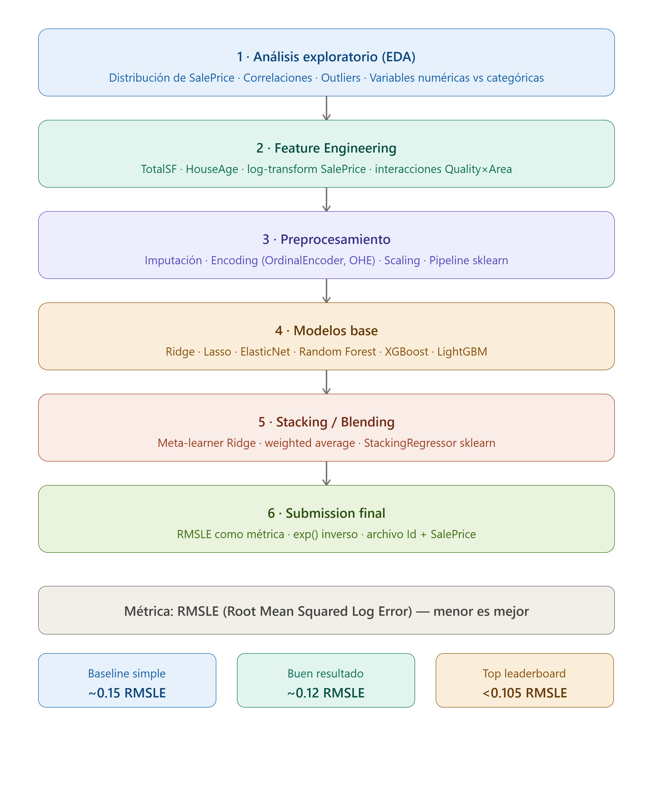

# 🏠 Ames House Prices — Advanced Regression Techniques

Este proyecto tiene como objetivo desarrollar un pipeline de Machine Learning de alto rendimiento para predecir el precio final de venta (`SalePrice`) de las viviendas residenciales en Ames, Iowa (2006–2010), basándose en 79 características explicativas.

El pipeline está diseñado siguiendo las mejores prácticas de la comunidad de Ciencia de Datos y Kaggle, apuntando a lograr un desempeño en el **Top 5%** del leaderboard (RMSLE < 0.105).

---

## 🗺️ Diagrama del Pipeline

El siguiente diagrama ilustra las fases del pipeline y las metas de desempeño en términos de la métrica RMSLE (Root Mean Squared Log Error):



---

## 🎯 1. Objetivo y Métrica de Evaluación

El objetivo es predecir la variable continua `SalePrice`. La métrica de evaluación oficial de la competición es el **RMSLE** (Root Mean Squared Log Error).

> [!IMPORTANT]  
> **¿Por qué usar el logaritmo?**  
> Penalizar los errores en casas de alto valor de la misma manera que en casas económicas distorsionaría el modelo. Al transformar `SalePrice` con el logaritmo natural (`np.log1p`), los errores se evalúan en términos de desviación porcentual y no en valores absolutos de dólares. Las predicciones finales se deben revertir con `np.expm1()`.

---

## 📊 2. Estructura del Dataset

El conjunto de datos consta de las siguientes particiones:
*   **`train.csv`**: 1,460 registros con las características físicas y de localización, incluyendo la variable objetivo (`SalePrice`).
*   **`test.csv`**: 1,459 registros con las mismas características, pero sin la columna `SalePrice`.

### Características Más Influyentes
*   **Calidad y Condición:** `OverallQual` (calidad general), `OverallCond` (condición general), `KitchenQual`, `ExterQual`.
*   **Espacio y Tamaño:** `GrLivArea` (superficie habitable), `TotalBsmtSF` (área del sótano), `1stFlrSF` (área del primer piso), `GarageArea`, `LotArea`.
*   **Entorno:** `Neighborhood` (vecindario físico — variable de alto poder predictivo).
*   **Fechas:** `YearBuilt` (año de construcción), `YearRemodAdd` (año de remodelación), `YrSold` (año de venta).

---

## 🛠️ 3. Fases del Pipeline de Ingeniería de Datos

### Fase A: Análisis Exploratorio de Datos (EDA) y Outliers
*   **Tratamiento del Target:** Aplicación de `np.log1p(train['SalePrice'])` para corregir el sesgo positivo (skewness) y normalizar la distribución.
*   **Remoción de Outliers:** Graficar `SalePrice` vs `GrLivArea` y eliminar propiedades con un área superior a los 4000 pies cuadrados pero con precios extremadamente bajos (ventas agrícolas o anomalías).

> [!WARNING]  
> Mantener estos outliers en el dataset de entrenamiento confunde a los modelos, especialmente a los lineales, dañando su capacidad de generalización.

---

### Fase B: Preprocesamiento e Imputación de Datos
Muchos valores nulos (`NaN`) en este dataset no significan pérdida de información, sino la ausencia de la característica en la propiedad.

#### 1. Imputación de Categóricas con `'None'`
Variables donde el valor nulo indica la ausencia de la característica:
```python
none_cols = [
    'PoolQC', 'MiscFeature', 'Alley', 'Fence', 'FireplaceQu',
    'GarageType', 'GarageFinish', 'GarageQual', 'GarageCond',
    'BsmtQual', 'BsmtCond', 'BsmtExposure', 'BsmtFinType1', 'BsmtFinType2',
    'MasVnrType', 'MSSubClass'
]
# Rellenar con "None"
```

#### 2. Imputación de Numéricas con `0`
Variables donde el valor nulo indica que la propiedad no tiene garaje, sótano o área de mampostería:
```python
zero_cols = [
    'GarageYrBlt', 'GarageArea', 'GarageCars', 'BsmtFinSF1', 'BsmtFinSF2',
    'BsmtUnfSF', 'TotalBsmtSF', 'BsmtFullBath', 'BsmtHalfBath', 'MasVnrArea'
]
# Rellenar con 0
```

#### 3. Imputación Inteligente y Restantes
*   **`LotFrontage` (pies de calle conectados a la propiedad):** Se imputa utilizando la **mediana** del área por vecindario (`Neighborhood`), dado que los lotes del mismo vecindario suelen tener dimensiones similares.
*   **Resto de numéricas:** Se imputan con la mediana global.
*   **Resto de categóricas:** Se imputan con la moda.

---

### Fase C: Ingeniería de Características (Feature Engineering)
La creación de variables combinadas e interacciones físicas y temporales proporciona un impulso sustancial al desempeño del modelo:

*   **Área Total Construida (`TotalSF`):** Resume el tamaño real en un único predictor.
    $$\text{TotalSF} = \text{TotalBsmtSF} + \text{1stFlrSF} + \text{2ndFlrSF}$$
*   **Baños Totales (`TotalBathrooms`):** Integra baños completos e individuales (otorgando peso de 0.5 a los medios baños).
    $$\text{TotalBathrooms} = \text{FullBath} + 0.5 \times \text{HalfBath} + \text{BsmtFullBath} + 0.5 \times \text{BsmtHalfBath}$$
*   **Antigüedad de la Propiedad (`HouseAge`):** 
    $$\text{HouseAge} = \text{YrSold} - \text{YearBuilt}$$
*   **Años desde la Remodelación (`RemodAge`):**
    $$\text{RemodAge} = \text{YrSold} - \text{YearRemodAdd}$$
*   **Casa Nueva (`IsNew`):** Indicador binario si el año de venta coincide con el año de construcción.
*   **Tiene Piscina (`HasPool`):** Indicador binario si `PoolArea > 0`.
*   **Área Total de Porche (`TotalPorch`):**
    $$\text{TotalPorch} = \text{OpenPorchSF} + \text{EnclosedPorch} + \text{3SsnPorch} + \text{ScreenPorch}$$

---

### Fase D: Codificación y Transformación (Encoding & Scaling)
*   **Variables Numéricas de Tipo Categórico:** Columnas como `MSSubClass` y `MoSold` (mes de venta) que están codificadas numéricamente se transforman a categóricas.
*   **Mapeo Ordinal Manual:** Variables ordinales basadas en texto (como las de calidad/condición: `Ex` (Excelente), `Gd` (Bueno), `TA` (Típico), `Fa` (Regular), `Po` (Pobre)) se mapean manualmente a enteros de 5 a 1.
*   **Codificación de Categóricas Nominales:** Aplicación de One-Hot Encoding a variables nominales de baja cardinalidad y Target Encoding o etiquetas numéricas a aquellas con alta cardinalidad (ej. `Neighborhood`).
*   **Corregir la Asimetría:** Aplicar transformaciones Logarítmicas o Box-Cox a las variables numéricas independientes que presenten un sesgo elevado.

---

## 🤖 4. Estrategia de Modelado y Ensamble

Al ser un conjunto de datos relativamente pequeño pero ancho (1,460 filas y muchas columnas tras el One-Hot Encoding), la combinación ganadora no radica en redes neuronales, sino en un ensamble de **Modelos Lineales Regularizados** y **Algoritmos basados en Árboles (Gradient Boosting)**.

| Modelo | Razón de Elección y Rol en el Pipeline |
| :--- | :--- |
| **Lasso / Ridge** | Excelente manejo de variables correlacionadas (tamaño, cuartos). Lasso realiza selección de características reduciendo coeficientes a cero. |
| **ElasticNet** | Robusto al combinar penalizaciones L1 y L2, ideal para controlar la multicolinealidad. |
| **XGBoost & LightGBM** | Capturan interacciones no lineales complejas de alta dimensionalidad. Tienen un desempeño líder en datos tabulares. |
| **Gradient Boosting (sklearn)** | Aporta diversidad y robustez al ensamble general. |

### Validación Cruzada y Blending

*   **K-Fold Cross-Validation:** Debido al tamaño del conjunto de datos, se requiere una validación cruzada estructurada de **5 o 10 splits** (`KFold(n_splits=10, shuffle=True, random_state=42)`) para evitar la varianza en la optimización de hiperparámetros.
*   **Optimización:** Búsqueda fina de parámetros utilizando `Optuna` o `GridSearchCV`.
*   **Blending Ponderado:** Promedio ponderado de las predicciones de los modelos en el espacio logarítmico para promediar las debilidades y consolidar las fortalezas de cada algoritmo:
    ```python
    final_pred = (
        0.30 * xgb_pred +
        0.25 * lgbm_pred +
        0.20 * lasso_pred +
        0.15 * ridge_pred +
        0.10 * elasticnet_pred
    )
    ```
    *Los pesos ideales del ensamble se calculan minimizando la métrica RMSLE sobre las predicciones Out-Of-Fold (OOF) mediante `scipy.optimize.minimize`.*

> [!TIP]  
> **Variables redundantes:** Columnas como `Utilities` (donde casi todos los registros tienen el mismo valor), `StreetCondition` o `PoolQC` (muy baja varianza) pueden ser eliminadas previamente o dejarse en manos del modelo Lasso para que apague sus coeficientes automáticamente.
